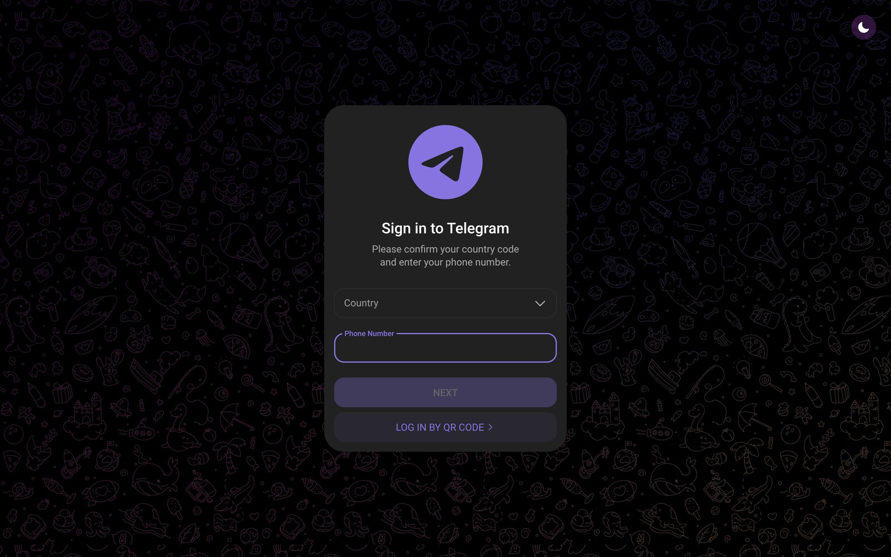
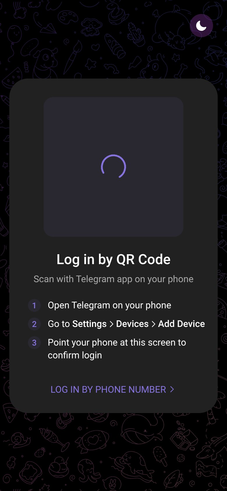

<div align="center">


# zWeb

Веб-мессенджер на базе Telegram Web K — со своим оформлением, плагинами и памятью чатов.
Настоящий клиент: вход по своему номеру, реальные переписки, реальные звонки.

[](https://t.me/frizovdanya)
[](https://github.com/frizovdanyash/zweb)

Создатель: **[@frizovdanya](https://t.me/frizovdanya)**

</div>

---

## Что такое zWeb

zWeb — самостоятельный форк Telegram Web K. Аккаунт, чаты, звонки и облако — обычные
телеграмные: вы входите по номеру и переписываетесь как в web.telegram.org, но получаете
фиолетово-чёрное оформление, движок плагинов, сохранение удалённых сообщений и десятки
настроек, которых в оригинале нет.

Всё, что добавляет zWeb, живёт в вашем аккаунте (раздел **Настройки → zWeb**) и
переносится между браузерами.

## Установка на свой сервер

Собирать ничего не нужно — готовая сборка уже лежит в `public/`.

### Вариант 1. Docker (рекомендуется)

```bash
docker compose up -d
```

Открыть `http://ваш-сервер:8080`.

### Вариант 2. Без Docker, один файл

```bash
node serve.js          # http://localhost:3000
PORT=80 node serve.js  # на 80-м порту
```

Файл `serve.js` не тянет зависимостей: gzip/brotli, кеш-заголовки, SPA-фолбэк — всё внутри.

### Вариант 3. Nginx / Apache / любой хостинг

Скопируйте содержимое папки `public/` в корень сайта. Готовый конфиг nginx —
`docker/nginx.conf`. **Нужен HTTPS** (без него Telegram не даёт войти и не работает push).

### Вариант 4. GitHub Pages / Cloudflare Pages / Netlify

Корень публикации — папка `public/`, тип проекта — статика, сборка не нужна.

## Приложение для Android (APK)

> **Скачать: [zweb.apk](https://github.com/frizovdanyash/zweb/releases/download/apk-latest/zweb.apk)**
> (~39 МБ) — открыть на телефоне и разрешить установку из этого источника.

Сборка zWeb **вшита внутрь APK**: приложение открывается сразу, без интернета
к своему серверу и без настройки домена. Иконка в лончере, без адресной строки,
микрофон и камера для звонков, ссылки `t.me` открываются внутри.

Понадобится интернет только для самого Telegram — как и в браузере.

В [релизе `apk-latest`](https://github.com/frizovdanyash/zweb/releases/tag/apk-latest)
рядом лежит `zweb-debug.apk`. Пересобирается автоматически на каждый пуш в `main`
(workflow «Сборка APK»), подробности — [docs/ANDROID.md](docs/ANDROID.md).

## Что внутри

### Основные
- **Сеть и загрузка** — скорость загрузки (выкл./быстро/ультра), ускорение выгрузки,
  число параллельных загрузок, IPv6, DNS-over-HTTPS (системный, Google, Cloudflare, свой),
  авто-повтор сорванных отправок, папка сохранения и подпапки по чатам.
- **Аккаунт для ботам** — отдельный номер для ботов, подтверждение каждого запроса.
- **Профиль** — относительное «был(а) в сети», скрытие номера, показ ID и дата-центра,
  дата регистрации.
- **Список чатов и архив** — сначала непрочитанные, без лимита закреплённых, скрытие
  архива, открытие архива потягиванием, отключение свайпа «Из архива», мини-аватарки
  отправителей, счётчики папок.
- **Уведомления** — выбор пуш-сервиса, вибрация, пузыри, сохранение уведомлений
  удалённых сообщений.

### Внешний вид
- Готовые темы **zWeb Dark** и **zWeb Light** (фиолетовый акцент `#8B5CF6` на чёрном).
- Закругление аватарок (квадрат ↔ круг), радиус секций настроек, элементы списков в
  стиле Material, пузыри без хвостика.
- Шапка: заголовок по центру, свой текст заголовка, скрытие строки поиска, историй
  и плавающей кнопки, снежинки.

### Чаты
Стикеры и эмодзи (размер, время на стикерах, стикер-приветствие), двойное нажатие
(реакция и эмодзи, шаг перемотки), сообщения (иконка «изменено», капсула непрочитанных,
результаты опросов до голосования, быстрые переходы), скрытие реакций (по типам чатов),
кнопок «Поделиться», «Подарок», поиска, звонка и «Отправить как», меню сообщения,
медиа (HD, камера, оригинальное качество, пауза при сворачивании, PiP, звук кнопками
громкости), поле ввода, админ-шорткаты, отключение глобального поиска и датчика приближения.

> Через `@calcmulabot` ничего не встроено — конвертации валют в zWeb нет.

### AyuMoments
- **Память чатов** — удалённые сообщения остаются в локальном архиве (срок хранения
  настраивается), сохраняются исходные версии отредактированных.
- **Режим призрака** — «прочитано» и «печатает» не уходят на сервер, с исключениями по чатам.
- **Фильтры** — regex-шаблоны (по одному в строке) скрывают сообщения из ленты.
- Архив открывается в том же экране: список чатов → сообщения.

### Плагины
Полноценный движок расширений с разрешениями: сеть, файлы, чтение и отправка сообщений,
ссылки, настройки. Плагины ставятся из файла, по ссылке или вставкой кода, включаются и
выключаются по одному, разрешения выдаются вручную, всё пишется в журнал. Есть безопасный
режим (плагины не грузятся) и «небезопасный» (проверки выключены).

Документация и API: [`docs/PLUGINS.md`](docs/PLUGINS.md) — она же открывается кнопкой
**Docs** на экране плагинов.

### Навигация
Нижняя панель навигации и вкладки в боковой панели вместо полноэкранных разделов.

## Разработка

```bash
pnpm install
pnpm start                                  # dev-сервер: http://localhost:8080
npx vite build                              # прод-сборка в dist/
cp -r dist/. public/ && rm -rf dist         # обновить готовую сборку
```

Требования: Node.js 22.18+ (или 24.11+), pnpm 11.

`pnpm start` поднимает dev-сервер с HMR: правки в `src/` видны сразу. Боевая сборка
складывается в `dist/`, оттуда переносится в `public/` — именно эту папку раздают
Docker, `serve.js` и GitHub Pages.

## Структура

```
src/config/zwebState.ts              состояние настроек zWeb и значения по умолчанию
src/langZWeb.ts                      строки zWeb (en/ru)
src/lib/zweb/plugins.ts              движок плагинов и песочница
src/lib/zweb/ayuMoments.ts           память чатов, режим призрака, фильтры
src/lib/zweb/markup.ts               CSS-переменные оформления
src/lib/zweb/start.ts                запуск всех функций после входа
src/components/sidebarLeft/tabs/zweb экраны настроек
src/scss/partials/_zweb.scss         стили форка
android/                             Android-проект (WebView-обёртка → APK)
public/                              готовая сборка: раздавайте её
```

## Как это выглядит

<div align="center">


<br><br>


</div>

## Лицензия

Код основан на [Telegram Web K](https://github.com/morethanwords/tweb) (Mozilla Public
License 2.0) и распространяется на тех же условиях — см. [LICENSE](LICENSE).
zWeb не связан с Telegram FZ-LLC.

## Частые вопросы

**Нужен ли сервер, чтобы просто пользоваться zWeb?**
Да, статику надо где-то раздать: Docker, `serve.js`, nginx, Cloudflare Pages — на выбор.
Никакого бэкенда, базы данных и API-ключей приложение не требует.

**Будут ли мои Telegram-аккаунты работать?**
zWeb ходит через официальный Telegram API тем же способом, что и web.telegram.org.
Номер, код, пароль и облачные чаты — ваши собственные. Сессия хранится в браузере.

**Куда пропадает всё, что я настроил?**
Настройки zWeb хранятся в аккаунте (как обычные настройки Telegram), архив AyuMoments —
локально в IndexedDB браузера. Плагины и их разрешения — тоже в аккаунте.

**Можно ли отключить все плагины одним движением?**
Да — «Безопасный режим» в разделе плагинов: приложение стартует без единого плагина.

**Обновлять как?**
`git pull && npx vite build && cp -r dist/. public/`, затем пересобрать образ
(`docker compose up -d --build`) или просто обновить файлы на хостинге.

## Благодарности

Спасибо команде Telegram и авторам Telegram Web K — за клиент, на котором всё это стоит.
И @frizovdanya — за сам zWeb.
